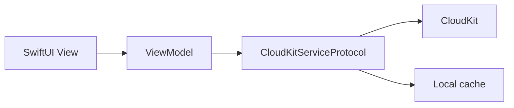
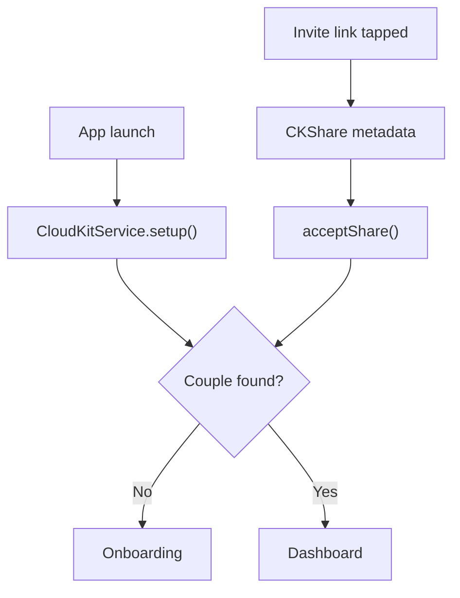

# Architecture

How Pekis is put together and why. For the story of the harder problems, see [docs/ENGINEERING_NOTES.md](docs/ENGINEERING_NOTES.md).

## Overview

Pekis is a SwiftUI app built around one idea: a paired couple that shares a few small features. It has three kinds of features:

- **Shared through CloudKit:** pairing, reunion date, love notes, daily moments, This or That answers.
- **Synchronized by a shared seed:** Word Search. Both phones build the same board locally.
- **Local only:** Date Roulette and Topic Generator, which read from content bundled in the app.

In one line: feature-based MVVM, a protocol-backed CloudKit service layer, a small local cache, and a few native iOS integrations (widget, notifications, haptics). There is no backend of my own.

## Code layout

```
Pekis/
├── App/        Entry point, app delegate, scene delegate
├── Core/
│   ├── Data/          Bundled content (prompts, date ideas, word list)
│   ├── DesignSystem/  Fonts, colors, card styles
│   ├── Models/        Domain models and their CloudKit mappings
│   ├── Services/      CloudKit, retry, account handling, matchmaking, puzzle generation
│   ├── Shared/        Code compiled into both the app and the widget
│   └── Utilities/     Haptics, logging, notifications, configuration
├── Features/   Home, Mascot, Onboarding, Settings
└── Shared/     Reusable UI components
PekisWidget/    WidgetKit extension
```

## MVVM and dependency injection

- **Views** describe layout and forward taps to a ViewModel.
- **ViewModels** are `@MainActor` `ObservableObject`s. They own feature state, call async service methods, and turn model data into something a view can show.
- **Services** hide persistence and sync behind protocols.

The app owns one `CloudKitService` as a `@StateObject` and passes it down as an environment object. Feature ViewModels take an `any CloudKitServiceProtocol` in their initializer, so previews and tests use `MockCloudKitService` instead.



## Startup and pairing

At launch the app asks for notification permission, sets up CloudKit (user ID, the custom `CoupleZone`, existing-couple lookup), subscribes to changes, and starts watching for iCloud account changes. The root view shows a loading screen, then onboarding if there is no couple yet, otherwise the dashboard.



Pairing works like this:

1. Partner A creates a `Couple` record in `CoupleZone` and gets a `CKShare` link for it.
2. Partner A sends the link from the share sheet.
3. Partner B taps it. The scene delegate receives the share metadata and the app accepts it, retrying the fetch a few times because CloudKit needs a moment to propagate.
4. Partner B's ID is saved on the couple record and the app asks for their name.

## Data and sync

**Why CloudKit.** Relationship data stays in the couple's own iCloud, `CKShare` fits the "two people share one space" model, and push, sharing and private/shared databases come built in.

**Two databases, one zone.** Partner A owns `CoupleZone` (private database). Partner B reaches the same zone through the shared database. Every read and write works out which one to use from the zone's owner (`CoupleDatabaseScope`).

**Models** (`Couple`, `LoveNote`, `ThisOrThatAnswer`, `MomentShareRecord`) each have a `recordType`, a `RecordKey` enum, `init?(record:)` and `toRecord(in:)`, so there is no loose dictionary handling in the sync code.

**Local cache.** Only the couple, love notes and This or That answers are cached (in `UserDefaults`) as a read fallback when a fetch fails. Photos are not cached, and writes made offline are not queued.

**Conflicts.** Last writer wins. Records are small and mostly append-only, so this is fine for two people. The notes file explains where it would break.

**Resilience.**
- `CloudKitRetry` retries transient errors (network loss, throttling, busy zone) with exponential backoff and honors the server's retry hint. Conflicts and permission errors are not retried.
- `AccountTransition` decides what to do when the iCloud account changes: keep cached data and show a message on sign-out, run setup on sign-in, and wipe local couple data if a different user signs in.

## Live updates

The service subscribes to both the private and shared databases. When data changes, CloudKit sends a silent push, the app delegate hands it to `CloudKitService.handleNotification`, the service refreshes the couple and posts a `Notification`, and each feature ViewModel refetches its own data.

## Features worth knowing about

**Moment Share.** The photo is compressed to JPEG, written to a temp file, and uploaded as a `CKAsset`.

**Word Search.** One short-lived `WordSearchSession` record in the couple zone holds a random seed and a scheduled start time. Both devices generate the identical board from the seed using a small deterministic generator, then count down to the same start time. Tile selection stays local, so this is synchronized play, not shared game state. When no couple is paired (solo play), a local `SimulationMatchmakingService` stands in.

**Countdown widget.** The widget never touches CloudKit. When the couple changes, the app writes a small snapshot to App Group `UserDefaults` and asks WidgetKit to reload. The shared model file compiles into both targets.

**Date Roulette and Topic Generator.** Pure local content from `AppContent`, no network.

## Concurrency

Services are `async throws`. `CloudKitService` and the ViewModels are `@MainActor`. Waits and retries use `Task.sleep`. Combine is only used for the Word Search session status streams.

## Tests, lint and CI

- 49 unit tests (Swift Testing, plus XCTest for the older Word Search tests). They cover record mapping, caching, the retry policy, account transitions, zone routing, pairing helpers, error mapping and puzzle generation, and none need iCloud.
- The UI test target only checks that the app launches.
- SwiftLint runs from `.swiftlint.yml`, locally on build and in CI. The project has zero warnings.
- GitHub Actions runs SwiftLint and the unit tests on pushes to `main` and on pull requests. It does not deploy anything.

## Limitations

- Offline support is partial: a read cache, no queued writes.
- The networked CloudKit code (share acceptance, record reads and writes) is tested by hand on devices, not by unit tests.
- Word Search is synchronized, not live shared state.
- Conflict handling is last-writer-wins.
