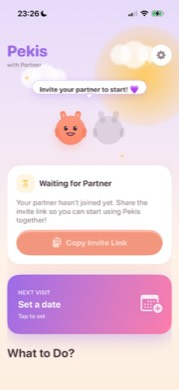
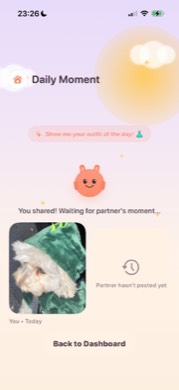
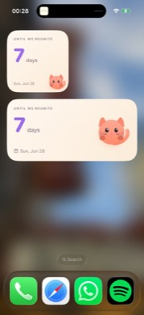
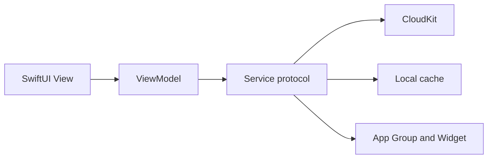

# Pekis 🐧

[](https://github.com/martinnss/pekis/actions/workflows/ci.yml)


**A shared space for long-distance couples, built on SwiftUI and CloudKit with no backend of my own.**

Two people pair through an invite link, then share love notes, a daily photo, a *This or That* compatibility game, a synchronized Word Search, and a Home Screen countdown to the day they next see each other. All relationship data lives in the couple's own iCloud. There is no server for me to run, secure or leak.

| Dashboard | Daily Moment | Countdown Widget |
| :---: | :---: | :---: |
|  |  |  |

## Why this project is technically interesting

The product is simple on purpose. The interesting part is making two phones agree with no server in between.

- **Pairing over CloudKit sharing.** One record zone is reached through *two different databases* (private for the owner, shared for the partner). Getting routing, subscriptions and the cold-launch share-link path right took real debugging.
- **Synchronized play without a game server.** Both phones generate the identical Word Search from one shared seed and count down to one shared start time. Same seed always gives the same board, and that property is unit-tested.
- **Resilient sync.** Transient failures retry with exponential backoff (and honor the server's retry hint). iCloud sign-out and account switches are handled so one user's data is never shown to another.
- **A widget that never touches the network.** The app pushes a tiny snapshot through an App Group and WidgetKit reloads from it.

**Read the [Engineering Notes](docs/ENGINEERING_NOTES.md)** for nine problems, each written up as symptom, cause, fix and lesson, plus a table of trade-offs I chose deliberately (last-writer-wins, no backend, synchronized vs. shared state) and where each would break.

## Features

- **Moment Share:** daily photo prompt, uploaded as a `CKAsset`
- **Love Notes:** shared notes that sync live through CloudKit push
- **This or That:** both partners answer, matches are revealed
- **Word Search:** synchronized puzzle with a waiting room and scheduled start
- **Date Roulette** and **Topic Generator:** local, offline content
- **Countdown Widget:** Home Screen and Lock Screen, configurable with App Intents

## Architecture

Feature-based **MVVM** with a **protocol-backed service layer**. ViewModels are `@MainActor` and depend on `CloudKitServiceProtocol`, so previews and tests can swap in a mock.



```
Pekis/
├── App/              # Entry point, app and scene delegates
├── Core/
│   ├── DesignSystem/ # Theme, fonts, card styles
│   ├── Models/       # Domain models and their CloudKit mappings
│   ├── Services/     # CloudKit (split into CloudKitService+*.swift), retry, matchmaking, puzzles
│   ├── Shared/       # Code compiled into both the app and the widget
│   └── Utilities/    # Haptics, logging, notifications, configuration
├── Features/         # Home, Mascot, Onboarding, Settings
└── Shared/           # Reusable UI components
PekisWidget/          # WidgetKit extension
PekisTests/           # 49 unit tests (Swift Testing + XCTest)
```

More detail: [ARCHITECTURE.md](ARCHITECTURE.md).

## Quality

- **49 unit tests** run in CI on every push and pull request, without needing iCloud.
- **SwiftLint** runs in CI and the code base has zero warnings.
- **Coverage:** about 99% on puzzle generation, 93 to 100% on the retry and account-transition logic, about 64% on models, and about 14% for the whole app target (SwiftUI views make up most of the lines).
- **Known gap:** the networked CloudKit I/O (share acceptance, record reads and writes) is verified manually on devices, not by unit tests. Decision logic around it is extracted and tested instead.

## Privacy

Couple data is stored in CloudKit's private and shared databases under the users' own Apple IDs. Nothing is sent to a server I operate. Details in [PRIVACY.md](PRIVACY.md); vulnerability reporting in [SECURITY.md](SECURITY.md).

## Build and run

Requires **Xcode 16+** and an iOS 17+ simulator or device.

```bash
git clone https://github.com/martinnss/pekis.git
cd pekis
cp .env.example .env     # then put in your own team ID, bundle ID and CloudKit container
open Pekis.xcodeproj
```

- **Unit tests** need no signing: `⌘U` in Xcode, or see [DEVELOPMENT.md](DEVELOPMENT.md) for the `xcodebuild` command.
- **Pairing and sync** need a signed build, an iCloud-signed-in simulator or device, and the iCloud/CloudKit capabilities for the identifiers in your `.env`.
- **Just want to see the UI?** Run an unsigned simulator build with the environment variable `PEKIS_SKIP_CLOUDKIT=1`.

## Known limitations and roadmap

- **Conflict resolution is last-writer-wins** (acceptable for two people and mostly append-only data). A per-field approach is the next step; see the trade-offs table in the notes.
- **Writes made offline are not queued.** Only a small read cache exists.
- **Networked CloudKit paths lack unit tests.** Next step: a thin database protocol with a fake.

## Contributing and license

Contributions are welcome, see [CONTRIBUTING.md](CONTRIBUTING.md). Released under the [MIT License](LICENSE). Changes are tracked in [CHANGELOG.md](CHANGELOG.md).

*Built by [Martin Olivares](https://github.com/martinnss) for long-distance couples everywhere.*
